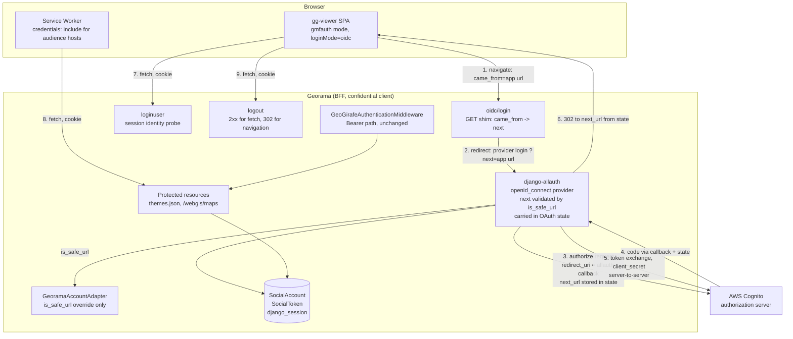
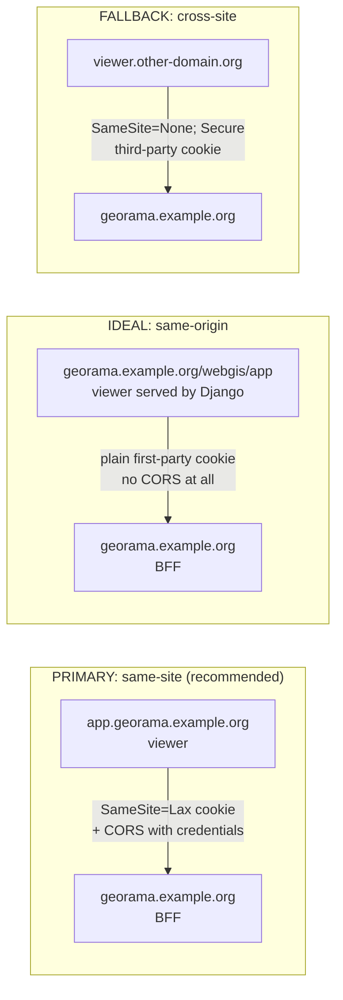
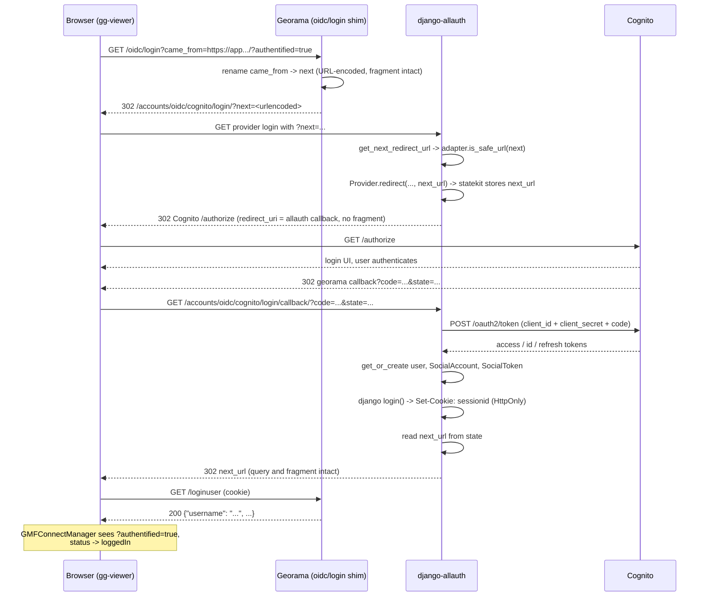
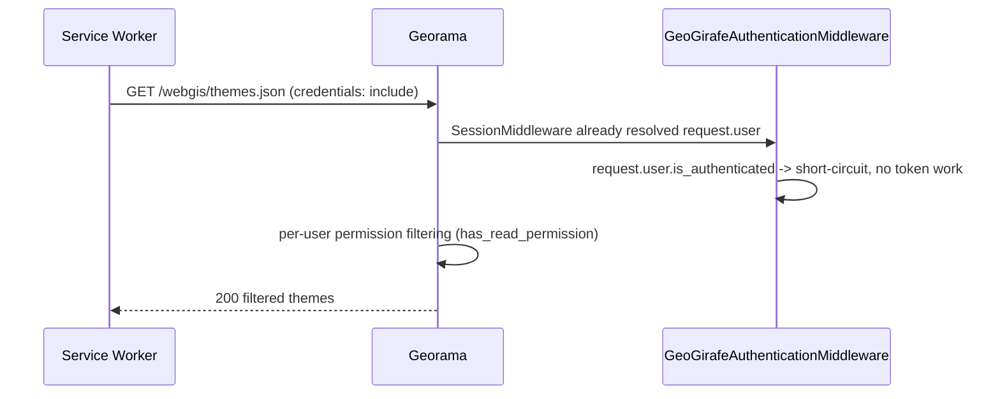

# Design Document: Georama BFF Authentication

## Overview

Georama becomes the Backend-For-Frontend (BFF) and the single confidential OAuth client against the identity provider (AWS Cognito). It negotiates the authorization code exchange server-side using its client secret, keeps every Cognito token on the server, and hands the gg-viewer SPA nothing but an `HttpOnly` Django session cookie. The viewer then reaches protected resources (`themes.json`, `/webgis/maps`) with that cookie alone. This is the pattern described in [Auth0's BFF article](https://auth0.com/blog/the-backend-for-frontend-pattern-bff/) and favoured by [RFC 9700](https://datatracker.ietf.org/doc/rfc9700/) (OAuth 2.0 Security Best Current Practice), which recommends keeping tokens out of browser-based public clients.

The immediate driver is that Cognito rejects gg-viewer's current browser-side OIDC login. `AbstractConnectManager.getLoginRedirectUrl` appends the application state as a URL fragment (`gg-viewer/src/tools/auth/abstractconnectmanager.ts:71`), and a `redirect_uri` must not carry a fragment component — AWS enforces this, RFC 6749 §3.1.2 forbids it, and Cognito offers no exact-match relaxation (no wildcards, no regex, no toggle). Cognito's discovery document also omits `end_session_endpoint`, which makes `openidconnectmanager.ts:283` throw on logout. BFF eliminates both problems structurally rather than working around them: the viewer's app URL (fragment included) travels to georama as a `came_from` **query parameter**, and the only `redirect_uri` Cognito ever sees is georama's existing, fragment-free allauth callback `/accounts/oidc/<provider_id>/login/callback/` — which already works with Cognito today. Logout becomes a server-side session concern, so the missing `end_session_endpoint` stops mattering.

The viewer side is already implemented upstream and needs **zero code changes**. `GMFConnectManager` is explicitly documented as a BFF client, activated by the `gmfauth` config block instead of `oauth`, and the service worker's cookie path (`service-worker-tools.ts:147`) is implemented and unit-tested. Georama's job is to serve the three endpoints that block hardcodes — `oidc/login`, `loginuser`, `logout` — and to make its session cookie usable from the viewer's origin. Everything else in georama stays as it is: the Bearer-token middleware path, HTTP Basic mode, the Keycloak provider configuration, and the Django admin login all keep working, because `GeoGirafeAuthenticationMiddleware.__call__` already short-circuits on `request.user.is_authenticated` (`core/auth/middleware.py:67-70`) and therefore lets a session-authenticated user drive the existing per-user permission filtering unchanged.

The custom surface is deliberately small. django-allauth 65.16.1 — already a georama dependency — supplies the return-URL plumbing (`next` parameter, safety validation, OAuth-state propagation) and the token store. What remains bespoke is the three viewer-facing endpoint shapes, one safety hook override, settings, and system checks. See [Package evaluation](#package-evaluation) for what was considered and rejected, and [Corrections to earlier analysis](#corrections-to-earlier-analysis) for the two claims this revision retracts.

---

## Corrections to earlier analysis

A previous revision of this document asserted that allauth validates its `next` parameter against `ALLOWED_HOSTS` only, and therefore would reject the viewer's cross-origin return URL. **That was wrong.** `DefaultAccountAdapter.is_safe_url(url)` allows relative URLs, and for absolute URLs requires HTTP(S) plus a host matching the request host, a host in `ALLOWED_HOSTS`, **or a host derived from `CSRF_TRUSTED_ORIGINS`**. It deliberately drops the `"*"` wildcard, honours `ALLOWED_HOSTS` subdomain `.`-prefix patterns via `django.http.request.validate_host`, and then delegates to `django.utils.http.url_has_allowed_host_and_scheme`.

Two consequences, both of which shrink this design:

1. Georama already lists the viewer origins in `CSRF_TRUSTED_ORIGINS` (`settings.py:487-495` for `Dev`), so a cross-origin `came_from` is **already** accepted with no custom code. The bespoke `CameFromValidator` described in the earlier revision is deleted.
2. Because allauth's `next` is already validated and already propagated through the OAuth state, the custom `bff_came_from` session key and the `get_login_redirect_url` override are deleted too.

If you are reading the diff: trust this section and the components below, not the earlier text.

---

## Package evaluation

The question "does an existing package already do this?" was asked directly and is answered here rather than in a side channel.

### `allauth.headless` — evaluated, does not fit

allauth ships a headless API intended exactly for SPA front ends. It is the closest existing fit and still does not work, for three independent reasons:

- **Login cannot be initiated.** `allauth.headless.socialaccount.views.RedirectToProviderView` defines only `post()`. Its OpenAPI entry for `POST /_allauth/browser/v1/auth/provider/redirect` states that because the call yields a user-facing 302, it is browser-only and must be made synchronously, non-XHR. gg-viewer starts login with `window.open(authorizationUrl, '_self')` — a GET navigation. The viewer cannot drive a POST-only endpoint without being forked, and zero viewer changes is a hard constraint here.
- **Identity response shape is wrong.** `GET /_allauth/{client}/v1/auth/session` returns allauth's envelope (a `status` plus a `data.user` object), not the flat `{"username": ...}` that `GMFManager.getUserInfo` consumes.
- **Logout status code is wrong.** `DELETE /_allauth/{client}/v1/auth/session` is the headless logout and responds **401 on success** by design (the session is gone, so the caller is unauthenticated). `GMFManager.logout` throws unless the response is 2xx.

So headless would need shim views anyway, plus a new installed app and URL namespace — added surface that removes none. Record it as the natural migration target if gg-viewer ever gains a native headless mode. Note that `RedirectToProviderForm.clean_callback_url` calls the same `is_safe_url` adapter hook this design overrides, so the override is forward-compatible with a later headless migration.

### Also evaluated and rejected

| Candidate | Why not |
|---|---|
| `mozilla-django-oidc` | Session-based OIDC RP, architecturally a BFF, and would work in isolation. But it is a *second* OIDC stack beside allauth, duplicating user provisioning and token storage. `GeoGirafeAuthenticationMiddleware` already resolves users via allauth's `SocialAccount`, so adopting it means maintaining two sources of truth for the same users. |
| `bffauth` (PyPI) | Not Django-integrated and young. Cited anyway because it correctly identifies BFF as the primary recommendation of the IETF `draft-ietf-oauth-browser-based-apps` BCP — independent support for this feature's rationale. |
| `Duende.BFF`, `Curity Token Handler` | .NET and commercial respectively. Prior art for the pattern, not usable here. |
| `dj-rest-auth` / DRF | Not applicable. Georama has no DRF, and three plain endpoints need no REST framework. |

**Conclusion**: no package replaces this feature, and allauth already covers the parts that would have been risky to write by hand. No new runtime dependency.

---

## Architecture



Properties of this topology:

- The browser never talks to Cognito's token endpoint, and never holds an access, ID, or refresh token.
- The only secret in the browser is the session cookie, which is `HttpOnly` and therefore out of reach of page JavaScript.
- Cognito only ever sees one `redirect_uri`, already registered and already working.
- The return URL lives in allauth's OAuth state, not in a georama-owned session key.
- Georama's authorization model is untouched: session auth and Bearer auth converge on `request.user` before any permission check runs.

### Deployment topology (key architecture decision)

Cookie viability is decided by deployment, not by code. Today georama runs on `localhost:4242` and the viewer on `9309`/`9308` — different origins *and* different ports on the same host, which in cookie terms is same-site but in CORS terms is cross-origin. In a realistic deployment the two land on different hostnames, and the question becomes whether they share a registrable domain.



| Topology | Cookie settings | CORS needed | Risk |
|---|---|---|---|
| Same-origin (ideal) | `SESSION_COOKIE_SECURE=True`, `SameSite=Lax`, no `DOMAIN` | No | None. Browser restrictions on third-party cookies are irrelevant. |
| Same-site, different subdomain (**primary**) | `SESSION_COOKIE_DOMAIN=.georama.example.org`, `SECURE=True`, `SameSite=Lax` | Yes (`CORS_ALLOWED_ORIGINS` + `CORS_ALLOW_CREDENTIALS`) | Low. Cookie is first-party. Note the cookie becomes visible to *all* subdomains of the shared domain. |
| Cross-site (fallback) | `SameSite=None`, `SECURE=True` | Yes | High. This is exactly the cookie class browsers are phasing down — the same fragile bet as relying on fragment tolerance. |

**Recommendation: primary (same-site), with same-origin as the documented end state.** Georama already has a stub for it: the `GeoGirafe` view at `webgis/views.py:465` is commented "prepared for later approach where we serve GeoGirafe directly through Django". Serving the viewer bundle from Django makes the viewer same-origin and moots cookie policy, CORS, and CSRF-origin questions entirely. The Auth0 article makes the same assumption — BFF presumes the SPA is hosted by the backend. The fallback must be documented but should not be the deployment plan.

`SameSite=Lax` (not `Strict`) is a hard requirement in every topology: the Cognito → georama callback is a top-level cross-site GET navigation, and `Strict` would suppress the session cookie carrying allauth's OAuth `state`, breaking the flow at step 4.

### Route naming decision

gg-viewer hardcodes GMF's path names relative to `gmfauth.url` (normalised with a trailing slash by `girafeconfig.ts`). Two options:

1. **Georama exposes aliases at those exact paths** (`oidc/login`, `loginuser`, `logout` at the georama root). Three `path()` entries, zero gg-viewer code change, config only. **Recommended.**
2. Make the paths configurable in gg-viewer's `gmfauth` block with defaults preserving current GMF behaviour. Cleaner as an upstream contribution — it would let any non-GMF backend act as a BFF — but requires an upstream merge and a viewer release. **Optional / future work.**

Note `APPEND_SLASH = False` (`settings.py:422`), so the route strings must match exactly, without trailing slashes.

### Related work (out of scope)

The gg-viewer `redirect_uri` fragment fix (moving app state out of the fragment, or into the `state` parameter) will be filed upstream independently. It is mentioned here so the reader understands the choice: that fix needs an upstream merge, a release, and would still leave tokens in the browser and still leave Cognito's missing `end_session_endpoint` to handle. BFF solves all three today with backend-only work.

---

## Sequence Diagrams

### Login



### Resource access



### Logout

```mermaid
sequenceDiagram
    participant B as Browser (gg-viewer)
    participant G as Georama
    participant C as Cognito

    B->>G: GET /logout (fetch, Sec-Fetch-Mode: cors)
    G->>G: allauth adapter.logout(request) -> session flushed, cookie cleared
    G-->>B: 200 {"loggedOut": true, "idpLogoutUrl": "..."}
    Note over B: GMFManager.logout requires 2xx;<br/>response body is ignored by the viewer
    Note over C: Cognito session persists.<br/>Next login may be silent SSO<br/>unless AUTH_PARAMS prompt=login is set.
```

---

## Components and Interfaces

Seven components, down from ten. The deletions are recorded in [Corrections to earlier analysis](#corrections-to-earlier-analysis).

### Component 1: `OidcLogin` view (`georama/core/views/bff.py`)

**Purpose**: a thin GET shim. Its entire job is to rename gg-viewer's `came_from` to allauth's `next` and hand off. It owns no validation, no session state, and no redirect logic.

**Interface**:
```python
class OidcLogin(View):
    def get(self, request: HttpRequest) -> HttpResponseRedirect: ...
```

**Responsibilities**:
- Read `came_from` from the query string and re-emit it as `next` on allauth's provider login URL, URL-encoded with `urlencode`. No parsing, no rewriting, no stripping — allauth validates it downstream via `adapter.is_safe_url`, and a rejected value simply falls back to `LOGIN_REDIRECT_URL`.
- Resolve the provider login URL with `reverse()`, never a hardcoded path. The URL name and kwargs (`openid_connect_login` with a `provider_id` kwarg) must be **confirmed by a test against the installed allauth**, not assumed from documentation.
- If the user already has a valid session, redirect straight to the target without involving Cognito, so a double login is harmless. The target must pass `get_adapter().is_safe_url()` before being used — this is the one place georama calls the hook directly, because allauth is not in the loop on that shortcut.

**Why fragment preservation is free**: `came_from` is URL-encoded inside the `next` query parameter, so `#fragment` and `?authentified=true` are opaque characters in transit. allauth stores the decoded value in the OAuth state and finishes with `HttpResponseRedirect(next_url)`, which emits the URL byte-for-byte. Nothing in the path re-encodes, reorders, or strips the fragment.

**On `SOCIALACCOUNT_LOGIN_ON_GET`**: already `True` (`settings.py:227`). That setting is what lets the viewer's GET navigation start the authorize redirect without an interstitial confirmation page. allauth's own documentation recommends POST-initiated provider login, on the grounds that a GET-triggered login is CSRF-able (an attacker can force a login). Georama accepts the GET for a concrete reason — gg-viewer uses `window.open(url, '_self')` and cannot be changed — and the exposure is bounded: forced login lands the victim in their own session on their own viewer, and the OAuth `state` still protects the callback. Recorded here so the acceptance is a conscious documented tradeoff rather than an inherited default.

### Component 2: `GeoramaAccountAdapter.is_safe_url` (`georama/core/auth/bff.py`)

**Purpose**: the one security-relevant line of custom code in this feature. Decides which absolute redirect targets allauth will honour.

**Interface**:
```python
class GeoramaAccountAdapter(DefaultAccountAdapter):
    def is_safe_url(self, url: str | None) -> bool:
        if super().is_safe_url(url):
            return True
        if not url:
            return False

        # "*" would make validate_host match everything: an open redirect.
        allowed = [h for h in settings.BFF_ALLOWED_VIEWER_HOSTS if h != "*"]
        if not allowed:
            return False

        try:
            netloc = urlsplit(url).netloc
        except ValueError:          # malformed IPv6 literal, bad port, ...
            return False
        if not netloc:
            return False

        domain, _port = split_domain_port(netloc)
        if not domain or not validate_host(domain, allowed):
            return False

        # Re-delegate with the exact netloc so Django still enforces scheme,
        # control-character, triple-slash and MAX_URL_LENGTH protections.
        return url_has_allowed_host_and_scheme(
            url,
            allowed_hosts={netloc},
            require_https=not settings.DEBUG,
        )
```

**Responsibilities**:
- Consult `super()` **first**, so every existing allauth behaviour — relative URLs, request host, `ALLOWED_HOSTS` including `.`-prefixed subdomain patterns, `CSRF_TRUSTED_ORIGINS`-derived hosts, the deliberate exclusion of `"*"` — is preserved exactly. Admin login, HTTP Basic, and the Keycloak browser flow are therefore untouched.
- Extend acceptance only to hosts explicitly declared in `BFF_ALLOWED_VIEWER_HOSTS`, matched with `ALLOWED_HOSTS` semantics via `validate_host`.
- Drop `"*"` from the allowlist before matching. `validate_host` treats `"*"` as matching every host, so honouring it here would be an unconditional open redirect. This is a deliberate deviation from `validate_host`'s default behaviour and is security-relevant, not cosmetic.
- Return `False` when the effective allowlist is empty, so an unconfigured or `"*"`-only deployment widens nothing.
- Require HTTPS outside `DEBUG`, so a production deployment cannot be redirected to a plaintext viewer.
- Return a boolean for any input; `urlsplit` is guarded against `ValueError`, and `url_has_allowed_host_and_scheme` is total and handles empty strings, protocol-relative URLs, credential-embedding authorities, control characters, and non-HTTP schemes.

**Why the allowlist must not be passed straight to `url_has_allowed_host_and_scheme`** (do not "simplify" this back): Django's `_url_has_allowed_host_and_scheme` ends with an exact set-membership test on `url_info.netloc` against `allowed_hosts`, plus a scheme check. That means no `.`-prefix subdomain support, no case folding, and the port compared as part of the string. `ALLOWED_HOSTS`-style `.`-prefix and `"*"` semantics live in `django.http.request.validate_host`, which Django's redirect helper never calls. Handing `BFF_ALLOWED_VIEWER_HOSTS` to it directly would make a `.`-prefixed entry match **nothing** — silently breaking the subdomain pattern this design and Requirement 11.2 both promise. allauth's own `DefaultAccountAdapter.is_safe_url` avoids the trap the same way: `validate_host` first, then the parsed host added to the allowed set before delegating.

**Resulting matching semantics** (several correctness properties depend on these):

| Input relative to an allowlist entry | Outcome | Why |
|---|---|---|
| Host case variation (`APP.Georama.Example.Org`) | **Matches** | `validate_host` lowercases both sides |
| `.`-prefixed entry vs. a subdomain | **Matches** | `validate_host` honours the `ALLOWED_HOSTS` prefix pattern |
| `"*"` entry | **Never matches** | Stripped before use |
| Punycode vs. Unicode spelling of the same label | Fails closed | No IDNA normalisation on either side |
| Explicit default port (`:80`, `:443`) | Fails closed | `netloc` must match the allowlisted host string |
| Trailing dot (`app.georama.example.org.`) | Fails closed | Not normalised away |
| Percent-encoded authority | Fails closed | No decoding before matching |
| User information before `@` | Fails closed | `split_domain_port` does not strip userinfo, so matching fails |

Fail-closed cases are rejections, not vulnerabilities: an operator who needs one of those spellings declares it literally in the allowlist.

**The tradeoff, stated explicitly**: georama could ship **zero** custom code here. The viewer origins are already in `CSRF_TRUSTED_ORIGINS`, so `super().is_safe_url()` alone accepts the `came_from` today. That is tempting and it is the fallback if the override is judged not worth its weight.

The reason to prefer the override as primary: `CSRF_TRUSTED_ORIGINS` answers "which origins may submit state-changing requests to us", and reusing it conflates that with "which origins are safe to send a user's browser to after authentication". They coincide today by accident of configuration, not by intent. An operator trimming `CSRF_TRUSTED_ORIGINS` for CSRF reasons would silently break login; an operator adding an origin for CSRF reasons would silently widen the redirect allowlist. `BFF_ALLOWED_VIEWER_HOSTS` keeps the redirect allowlist an auditable, independently reviewable declaration. Note also that `Prod.CSRF_TRUSTED_ORIGINS` defaults to `[]` (`settings.py:538`), so the zero-config path depends entirely on deployment-time configuration being right.

Cost of the override: one setting, one method, a handful of parametrised tests.

### Component 3: `LoginUser` view (`georama/core/views/bff.py`)

**Purpose**: GMF-compatible "who am I" endpoint. Georama has no equivalent today, and allauth's headless `session` endpoint has the wrong shape (see [Package evaluation](#package-evaluation)).

**Interface**:
```python
class LoginUser(View):
    def get(self, request: HttpRequest) -> JsonResponse: ...
```

**Responsibilities**:
- **Always** return HTTP 200 with a JSON body. gg-viewer does `fetch(url).then(r => r.json())` with no status check (`gmfmanager.ts:71-74`); a 401 with a non-JSON body would throw inside the viewer.
- Anonymous → a body with no non-empty `username`. gg-viewer treats that as logged out (`gmfconnectmanager.ts:107-112`).
- Authenticated → at minimum `username`; plus `email`, `display_name`, `is_staff`, `roles` for usefulness.
- Send `Cache-Control: no-store` and `Vary: Cookie` so no proxy or browser cache ever serves one user's identity to another.
- Perform no writes beyond Django's own session touch.

### Component 4: `Logout` view (replaces `georama/core/views/auth.py:Logout`)

**Purpose**: one path, two callers. gg-viewer calls `GET {url}logout` with `fetch()` and throws unless the response is 2xx (`gmfmanager.ts:61-64`); the existing server-rendered flow expects a redirect to the landing page.

**Interface**:
```python
class Logout(View):
    def get(self, request: HttpRequest) -> HttpResponse: ...
    def post(self, request: HttpRequest) -> HttpResponse: ...
```

**Responsibilities**:
- Log out through allauth: `get_adapter().logout(request)`, which calls `django.contrib.auth.logout` and keeps allauth's own logout signal handling and cleanup intact. Do not call `django.contrib.auth.logout` directly.
- Discriminate on the `Sec-Fetch-Mode` request header: `navigate` → 302 to the landing page (existing behaviour preserved); anything else (`cors`, `same-origin`, `no-cors`, or header absent) → 200 JSON. `fetch()` always sends a non-`navigate` value in every browser that supports service workers, which is the same browser set gg-viewer already requires.
- Include `idpLogoutUrl` in the JSON body when `BFF_IDP_LOGOUT_URL` is configured. The viewer ignores the body today; the field exists so a future viewer version, or a georama-served page, can complete a global sign-out.
- Be idempotent: logging out twice returns 2xx both times.

### Component 5: URL aliases (`georama/core/urls.py`)

```python
urlpatterns = [
    # BFF endpoints consumed by gg-viewer in gmfauth mode.
    # These three paths are literal because gg-viewer's GMFConnectManager/GMFManager
    # hardcodes them; APPEND_SLASH is False, so they must match exactly.
    # Everything georama resolves internally uses reverse() and these names.
    path("oidc/login", bff.OidcLogin.as_view(), name="bff-oidc-login"),
    path("loginuser", bff.LoginUser.as_view(), name="bff-loginuser"),
    path("logout", bff.Logout.as_view(), name="logout"),  # replaces auth.Logout
    ...
]
```

`/login` (`auth.Login`) stays as-is for the admin/password flow.

### Component 6: `TokenStore` (`georama/core/auth/bff.py`)

**Purpose**: own the answer to "where are the Cognito tokens, and who refreshes them".

**Interface**:
```python
class TokenStore:
    def get(self, user: User) -> SocialToken | None: ...
    def is_expired(self, token: SocialToken, leeway_seconds: int = 30) -> bool: ...
    def refresh(self, token: SocialToken) -> SocialToken | None: ...
    def access_token_for(self, user: User) -> str | None: ...
```

**Responsibilities**:
- Read and write through allauth's own tables: `SocialToken.token` = access token, `SocialToken.token_secret` = refresh token, `SocialToken.expires_at` = access-token expiry. This requires `SOCIALACCOUNT_STORE_TOKENS = True`, because django-allauth 65.x defaults it to `False`.
- Refresh **lazily**, only when a caller actually needs a valid Cognito access token for a downstream call — using the discovery document's `token_endpoint` with `client_id` + `client_secret` (georama is a confidential client, so this is a plain server-to-server POST).
- Never be on the critical path of `loginuser`, `themes.json`, or `/webgis/maps`. Georama's authorization is driven by the Django session and Django permissions, not by a live token.

**Why not cache or session storage**: the tokens are per-user durable state that outlives a single session, allauth already models them with the right relations, and the admin can inspect and revoke them. Putting them in the Django session would duplicate allauth's model and tie token lifetime to cookie lifetime; putting them in the cache would make them evictable, and `QSL_REDIS_URL` is currently dedicated to the job queue.

**Refresh strategy and the 10-minute poll**: the viewer's `loginuser` poll (`gmfconnectmanager.ts:111`, `expiresInMs = 600000`) is a *session liveness* check, not a token refresh — the viewer has no token to refresh. Treat it as such:
- `SESSION_SAVE_EVERY_REQUEST = True` turns the poll into a sliding session expiry, so an active viewer never gets logged out mid-session.
- `SESSION_COOKIE_AGE` should be set deliberately and documented; aligning it with Cognito's refresh-token lifetime keeps the Django session from outliving georama's ability to act for the user.
- Optional `BFF_LOGINUSER_VERIFY_IDP` (default `False`): when enabled, `loginuser` additionally refreshes an expired access token and logs the user out if the refresh fails, making the poll a true IdP-liveness check. Cost is one token-endpoint call per user per 10 minutes, which is why it is opt-in.

### Component 7: Settings (`georama/core/settings.py`)

Configuration follows the existing `django-configurations` style — `values.*` descriptors with `environ_prefix="GEORAMA"` — so BFF settings are declared, typed, and overridable the same way as every other georama setting.

```python
class Base(Configuration):
    # --- BFF ---
    BFF_ENABLED = values.BooleanValue(False, environ_prefix="GEORAMA")
    BFF_ALLOWED_VIEWER_HOSTS = values.ListValue(
        [], separator=" ", environ_prefix="GEORAMA"
    )  # hosts, not origins: "app.georama.example.org" or ".georama.example.org"
    BFF_IDP_LOGOUT_URL = values.Value("", environ_prefix="GEORAMA")
    BFF_LOGINUSER_VERIFY_IDP = values.BooleanValue(False, environ_prefix="GEORAMA")

    # --- session cookie (no SESSION_COOKIE_* setting exists today) ---
    # Stock Django settings only. No custom cookie handling anywhere in this feature.
    SESSION_COOKIE_HTTPONLY = True          # Django default, pinned explicitly
    SESSION_COOKIE_SECURE = values.BooleanValue(True, environ_prefix="GEORAMA")
    SESSION_COOKIE_SAMESITE = values.Value("Lax", environ_prefix="GEORAMA")  # never "Strict"
    SESSION_COOKIE_DOMAIN = values.Value(None, environ_prefix="GEORAMA")
    SESSION_COOKIE_AGE = values.IntegerValue(43200, environ_prefix="GEORAMA")
    SESSION_SAVE_EVERY_REQUEST = values.BooleanValue(True, environ_prefix="GEORAMA")

    # --- allauth ---
    ACCOUNT_ADAPTER = "georama.core.auth.bff.GeoramaAccountAdapter"
    SOCIALACCOUNT_STORE_TOKENS = True       # allauth 65.x defaults to False
```

`BFF_ALLOWED_VIEWER_HOSTS` holds **hosts**, matching the contract of `url_has_allowed_host_and_scheme` and of `ALLOWED_HOSTS` — including `.`-prefixed subdomain wildcards. Scheme is constrained separately by `require_https`, and port is part of the host string when non-default.

`Dev` keeps `SESSION_COOKIE_SECURE = False` for plain-HTTP localhost; `Prod` must not.

### Component 8: System checks (`georama/core/checks.py`)

Misconfiguration here fails silently and confusingly — the viewer loops login → logged-out with no server-side error. Django's system check framework is the idiomatic home for catching it: checks run on `manage.py check`, `runserver`, and `migrate`, they are testable in isolation, and they report through one consistent channel. Import-time `assert`s would be worse on all three counts.

```python
from django.core.checks import Error, Warning, register

@register()
def check_bff_configuration(app_configs, **kwargs):
    errors = []
    # Error: enabled with an empty redirect allowlist -> login always falls back.
    # Error: SESSION_COOKIE_SAMESITE == "None" with SECURE False -> browsers reject outright.
    # Warning: an allowed viewer host absent from CORS_ALLOWED_ORIGINS -> blocked fetches.
    # Warning: an allowed viewer host not same-site with SESSION_COOKIE_DOMAIN -> no cookie sent.
    return errors
```

`Error` blocks startup; `Warning` surfaces a diagnosable misconfiguration without refusing to boot. Each check gets a unique `id` (`georama.bff.E001` and so on) so deployments can silence one deliberately via `SILENCED_SYSTEM_CHECKS`.

### Component 9: CSRF re-enablement (`settings.py:264`)

`CsrfViewMiddleware` is currently commented out. Once ambient cookies authenticate requests, every unsafe-method endpoint becomes CSRF-attackable, so re-enabling it is in scope — the Auth0 article lists CSRF defence as a BFF requirement alongside `Secure` and `HttpOnly`. Audited surface:

| Endpoint | Caller | Decision |
|---|---|---|
| `/login` (POST) | server-rendered `admin/login.html` | Protected. Template emits ``. |
| `core/assign_permission_to_user_or_group`, `.../remove_...` (POST) | `permission_table.html` fetch with `X-CSRFToken` | Protected. Already sends the header. |
| `data_integration` project delete (POST) | `core/delete_preview.html` | Protected. Template emits ``. |
| entity forms (POST) | `core/form.html` | Protected. Template emits ``. |
| `/webgis/maps` (POST, WFS GetFeature — `maps/views.py:394`) | gg-viewer / service worker, XML body | `@csrf_exempt` + viewer-origin check. The viewer sends no token and cannot be changed. |
| `/webgis/short/create` (POST) | `GeoGirafeShareManager`, form-encoded, no token | `@csrf_exempt` + viewer-origin check. |
| `/oidc/login`, `/loginuser`, `/logout` (GET) | gg-viewer | Unaffected by `CsrfViewMiddleware`. |

Both exemptions are applied the Django way, at the class level on the CBV:

```python
@method_decorator(csrf_exempt, name="dispatch")
@method_decorator(require_viewer_origin, name="dispatch")
class WfsGetFeature(View):
    ...
```

The two exemptions are the honest cost of not forking the viewer, and both are narrow:
- `/webgis/short/create` already accepts anonymous POSTs and only stores a URL that must start with `settings.WEBGISURL`. It holds no per-user state, so a forged request gains an attacker nothing beyond a row they could have created directly. Rate limiting is a sensible follow-up, not a CSRF matter.
- `/webgis/maps` POST is a read operation (WFS GetFeature) expressed as POST because of body size. A forged request returns data to georama, not to the attacker — the response is unreadable cross-origin without CORS approval. The permission filter still applies.

Defence in depth for both: a `require_viewer_origin` decorator rejecting unsafe methods whose `Origin` header is absent or outside `BFF_ALLOWED_VIEWER_HOSTS` ∪ own origin. `CSRF_TRUSTED_ORIGINS` is already populated (`settings.py:295`, `settings.py:487`) but only relaxes the Origin/Referer check — it does not substitute for a token, which is why exemptions rather than trusted origins are the mechanism here.

### Component 10: Cognito provider configuration

Cognito slots into the existing `SOCIALACCOUNT_PROVIDERS["openid_connect"]` block (`settings.py:231-253`) with no code change — only env values:

```
GEORAMA_OIDC_PROVIDER_ID=cognito
GEORAMA_OIDC_NAME=Cognito
GEORAMA_OIDC_CLIENT_ID=<app client id>
GEORAMA_OIDC_SECRET=<app client secret>     # confidential client
GEORAMA_OIDC_SERVER_URL=https://cognito-idp.<region>.amazonaws.com/<pool-id>/.well-known/openid-configuration
GEORAMA_OIDC_LOGOUT_URL=https://<domain>.auth.<region>.amazoncognito.com/logout
```

Cognito-specific behaviour to document:

- **Allowed callback URL** in the Cognito app client must be exactly `https://georama.example.org/accounts/oidc/cognito/login/callback/`. Exact match, no fragment — which is the whole point of this design.
- **No `end_session_endpoint`** in discovery, so allauth performs no RP-initiated logout and nothing in georama may assume that key exists. Local Django logout is the contract gg-viewer needs, and it is sufficient for the viewer's purposes.
- **Global sign-out** uses Cognito's non-standard `GET /logout?client_id=...&logout_uri=...` with exact-match registered sign-out URLs. It requires a **top-level browser navigation**, and gg-viewer calls logout via `fetch()` — so georama cannot trigger it on the viewer's behalf. Consequence: after logout, the Cognito session persists and the next `oidc/login` may complete silently via SSO. Mitigations, in order of preference: (a) serve the viewer from Django and use a navigation-based logout; (b) set `AUTH_PARAMS = {"prompt": "login"}` on the provider app to force re-authentication, at the cost of losing legitimate SSO; (c) shorten the Cognito session duration. Pick per deployment and document the choice.
- **`PROVIDER_ID` migration**: the provider is selected by `OIDC_PROVIDER_ID` (today `keycloak`). `SocialAccount` rows store `provider` as that string, and `GeoGirafeAuthenticationMiddleware.get_or_create_user` looks up `provider=settings.OIDC_PROVIDER_ID`. Changing the value on a deployment with existing accounts **orphans those rows** and silently creates duplicate users on next login. If Cognito replaces Keycloak on an existing deployment, a data migration must re-point `SocialAccount.provider` (and `uid`, if the `sub` values differ between IdPs — they will). Running both providers side by side requires allauth app entries for each, which the current single-app `SOCIALACCOUNT_PROVIDERS` property does not model; that is a separate change and is called out, not designed, here.

---

## Data Models

### `SocialAccount` / `SocialToken` (existing, django-allauth)

No schema change. Documented here because this design makes them load-bearing.

```python
# allauth.socialaccount.models
class SocialAccount:
    user: User
    provider: str        # == settings.OIDC_PROVIDER_ID
    uid: str             # OIDC "sub"
    extra_data: dict     # claims

class SocialToken:
    app: SocialApp | None
    account: SocialAccount
    token: str           # access token
    token_secret: str    # refresh token
    expires_at: datetime | None
```

**Validation rules**:
- `(provider, uid)` is unique — the lookup key used by both the Bearer middleware and allauth.
- `token_secret` is only populated when the IdP returns a refresh token; Cognito does so when the `offline_access`-equivalent scope is granted by the app client.
- These rows are secrets at rest. They must never be serialised into any response, including `loginuser`.

### `LoginUserResponse` (new, response contract only — no DB model)

```python
@dataclass
class LoginUserResponse:
    username: str | None          # REQUIRED by gg-viewer; None/absent => logged out
    email: str | None = None
    display_name: str | None = None
    is_staff: bool = False
    roles: list[str] = field(default_factory=list)
```

**Validation rules**:
- Serialised with HTTP 200 in all cases, including anonymous.
- `username` is the only field gg-viewer reads; everything else is additive and safe to extend.
- Must never include tokens, `extra_data`, session keys, or permission internals.

### Return-URL state (owned by allauth, not by georama)

There is **no georama-owned session key**. The return URL lives in allauth's OAuth state:

```
?came_from=<url>            # gg-viewer -> georama, query parameter
?next=<urlencoded url>      # georama -> allauth, validated by adapter.is_safe_url
statekit state entry        # allauth -> Cognito -> allauth, carries next_url
HttpResponseRedirect(url)   # allauth -> browser, query and fragment intact
```

**Validation rules**:
- `next` is validated once by `allauth.account.utils.get_next_redirect_url` via `get_adapter().is_safe_url()` before it enters the state, and the state is integrity-protected by allauth.
- A rejected `next` is simply dropped, and login completes at `LOGIN_REDIRECT_URL`.
- Nothing is written for admin or Keycloak browser logins, which is what keeps their behaviour unchanged.

---

## Key Functions with Formal Specifications

### `GeoramaAccountAdapter.is_safe_url(url)`

```python
def is_safe_url(self, url: str | None) -> bool:
    """True iff allauth may redirect a browser to url."""
```

**Preconditions:**
- `url` is `None` or any `str` whatsoever, including hostile input. No other precondition.
- `settings.BFF_ALLOWED_VIEWER_HOSTS` is a sequence of host patterns with `ALLOWED_HOSTS` semantics, i.e. accepted by `django.http.request.validate_host` — bare hosts and `.`-prefixed subdomain patterns. Entries may include a non-default port as part of the host string.

**Postconditions:**
- Returns a `bool` for every input; never raises, including on `url` values that make `urlsplit` raise `ValueError`.
- Returns `True` whenever `super().is_safe_url(url)` does — so relative URLs, the request host, `ALLOWED_HOSTS` patterns, and `CSRF_TRUSTED_ORIGINS`-derived hosts keep working unchanged, and `"*"` keeps being excluded.
- Returns `False` whenever the allowlist with `"*"` entries removed is empty, regardless of `url`.
- Beyond `super()`, returns `True` only when **all** of the following hold: `url` has a non-empty `netloc`; `split_domain_port(netloc)` yields a non-empty domain; `validate_host(domain, allowed)` is `True` for the `"*"`-stripped allowlist; and `url_has_allowed_host_and_scheme(url, allowed_hosts={netloc}, require_https=not DEBUG)` is `True` — which is what keeps Django's scheme, control-character, triple-slash, and `MAX_URL_LENGTH` checks in force.
- Host matching is case-insensitive and honours `.`-prefix patterns. It does **not** normalise punycode, trailing dots, explicit default ports, percent-encoded authorities, or userinfo; each of those fails closed.
- `"*"` in the allowlist never widens acceptance.
- Does not mutate `url`, the allowlist, the session, or any model.
- Monotonic in the allowlist: adding a non-`"*"` host never turns a `True` into a `False`.

**Loop Invariants:** N/A — the `"*"` filter is a single pass with no accumulated state, and host matching is delegated to Django.

### `OidcLogin.get(request)`

```python
def get(self, request: HttpRequest) -> HttpResponseRedirect:
    """Rename came_from to next and hand off to allauth."""
```

**Preconditions:**
- `settings.BFF_ENABLED` is `True` and `settings.BFF_ALLOWED_VIEWER_HOSTS` is non-empty (enforced by the system check).
- `SessionMiddleware` and `AuthenticationMiddleware` have run.

**Postconditions:**
- Response is a 302. Its `Location` is either `reverse()`'d allauth provider login (same-origin, relative) carrying a URL-encoded `next`, or — when the user is already authenticated — a target that passed `get_adapter().is_safe_url()`, or `LOGIN_REDIRECT_URL`.
- The `next` value is the `came_from` input re-encoded only by `urlencode`; no characters are added, dropped, or reordered.
- No user is logged in or out by this view, and no georama session key is written.
- If `request.user.is_authenticated`, no request is made to Cognito.

**Loop Invariants:** N/A.

### `LoginUser.get(request)`

```python
def get(self, request: HttpRequest) -> JsonResponse:
    """GMF-compatible identity probe."""
```

**Preconditions:**
- `AuthenticationMiddleware` has run, so `request.user` exists (possibly `AnonymousUser`).

**Postconditions:**
- `response.status_code == 200` for every input, authenticated or not.
- Body is valid JSON and parses to an object.
- `body.get("username")` is truthy **iff** `request.user.is_authenticated`.
- When authenticated, `body["username"] == request.user.get_username()`.
- Body contains no key whose value is a token, a session key, or `SocialAccount.extra_data`.
- `Cache-Control` contains `no-store`; `Vary` contains `Cookie`.
- No user is created, logged in, or logged out.

**Loop Invariants:** N/A.

### `Logout.get(request)`

```python
def get(self, request: HttpRequest) -> HttpResponse:
    """Clear the georama session via allauth; shape the response for the caller."""
```

**Preconditions:**
- `request.session` exists. `request.user` may be anonymous.

**Postconditions:**
- After the call, `request.session.session_key` is `None` or references a flushed session; the response clears the session cookie.
- Logout went through `get_adapter().logout(request)`, so allauth's signal handling ran.
- `2xx` when `Sec-Fetch-Mode != "navigate"`; `302` to the landing page when it is `navigate`.
- Idempotent: a second call produces the same status class and leaves the user anonymous.
- A subsequent `loginuser` on the same cookie reports logged out.
- No Cognito request is made.

**Loop Invariants:** N/A.

### `TokenStore.access_token_for(user)`

```python
def access_token_for(self, user: User) -> str | None:
    """Return a currently-valid Cognito access token, refreshing if needed."""
```

**Preconditions:**
- `user` is persisted and may or may not have a `SocialAccount` for `settings.OIDC_PROVIDER_ID`.

**Postconditions:**
- Returns `None` when there is no stored token, or when refresh fails.
- Any returned token has `expires_at > now + leeway`.
- On a successful refresh, `SocialToken.token` and `expires_at` are updated and `token_secret` is replaced only if the IdP returned a new refresh token.
- A failed refresh does not delete the user, the `SocialAccount`, or the Django session — georama's own authorization does not depend on the token.
- Never raises on network failure; logs and returns `None`.

**Loop Invariants:** N/A (single refresh attempt, no retry loop — retries belong to the caller).

### `check_bff_configuration(app_configs, **kwargs)`

```python
@register()
def check_bff_configuration(app_configs, **kwargs) -> list[CheckMessage]:
    """Django system check for BFF misconfiguration."""
```

**Preconditions:**
- Settings are loaded. No database access is permitted (checks run before `migrate`).

**Postconditions:**
- Returns a list of `django.core.checks.Error` / `Warning` instances, each with a unique `georama.bff.*` id.
- Returns `[]` when `BFF_ENABLED` is `False` — the feature is off, so none of its invariants apply.
- Emits an `Error` when `BFF_ENABLED` is `True` and `BFF_ALLOWED_VIEWER_HOSTS` is empty.
- Emits an `Error` when `SESSION_COOKIE_SAMESITE == "None"` and `SESSION_COOKIE_SECURE` is `False`.
- Performs no I/O and never raises.

**Loop Invariants:** over the allowlist scan: the accumulated message list contains one message per host examined at most, and no message references a host not in the allowlist.

---

## Algorithmic Pseudocode

### BFF login entry

```pascal
ALGORITHM oidcLogin(request)
INPUT:  request with optional query parameter came_from
OUTPUT: redirectResponse

BEGIN
  ASSERT settings.BFF_ENABLED = TRUE
  ASSERT length(settings.BFF_ALLOWED_VIEWER_HOSTS) > 0   // system check guarantees this

  cameFrom <- request.query["came_from"]                 // untrusted, NOT parsed here

  IF request.user.isAuthenticated THEN
    // Already have a session: no reason to involve the authorization server.
    // allauth is not in the loop here, so call its safety hook directly.
    IF cameFrom <> NULL AND adapter.isSafeUrl(cameFrom) THEN
      RETURN redirect(cameFrom)
    END IF
    RETURN redirect(settings.LOGIN_REDIRECT_URL)
  END IF

  loginUrl <- reverseUrl("openid_connect_login",
                         providerId := settings.OIDC_PROVIDER_ID)

  IF cameFrom = NULL OR trim(cameFrom) = "" THEN
    RETURN redirect(loginUrl)
  END IF

  // Hand the value to allauth as "next". allauth validates it with
  // adapter.isSafeUrl and stores it in the OAuth state; a rejected value is
  // dropped and login completes at LOGIN_REDIRECT_URL.
  // urlencode is the ONLY transformation: the fragment and the query of
  // cameFrom become opaque characters inside the next parameter.
  RETURN redirect(loginUrl + "?" + urlencode({ "next": cameFrom }))
END
```

**Preconditions:** session and auth middleware have run; system checks passed at startup.

**Postconditions:** exactly one 302 is returned; no authentication state changes; no georama session key is written; `came_from` is transmitted unmodified apart from URL encoding.

**Loop Invariants:** N/A.

### Redirect safety decision

```pascal
ALGORITHM isSafeUrl(url)
INPUT:  url of type String OR Null
OUTPUT: safe of type Boolean

BEGIN
  // 1. Everything allauth already allows stays allowed. This covers relative
  //    URLs, the request host, ALLOWED_HOSTS (including ".sub" patterns via
  //    validate_host), and hosts derived from CSRF_TRUSTED_ORIGINS. It
  //    deliberately excludes the "*" wildcard.
  IF defaultAccountAdapter.isSafeUrl(url) THEN
    RETURN TRUE
  END IF

  IF url = NULL OR url = "" THEN
    RETURN FALSE
  END IF

  // 2. "*" matches every host in validate_host, which would be an open
  //    redirect. Strip it, and refuse if nothing declarative remains.
  allowed <- [ h FOR h IN settings.BFF_ALLOWED_VIEWER_HOSTS WHERE h <> "*" ]
  IF length(allowed) = 0 THEN
    RETURN FALSE
  END IF

  // 3. Parse. urlsplit raises ValueError on e.g. a malformed IPv6 literal.
  TRY
    netloc <- urlsplit(url).netloc
  CATCH ValueError
    RETURN FALSE
  END TRY

  IF netloc = "" THEN
    RETURN FALSE                     // relative URL already handled by super()
  END IF

  // 4. ALLOWED_HOSTS semantics: case-insensitive, ".sub" prefix patterns.
  //    These live in validate_host, NOT in urlHasAllowedHostAndScheme, whose
  //    final test is exact set membership on netloc. Passing the allowlist
  //    straight to the latter would make every ".sub" entry match nothing.
  (domain, port) <- splitDomainPort(netloc)
  IF domain = "" OR NOT validateHost(domain, allowed) THEN
    RETURN FALSE
  END IF

  // 5. Re-delegate with the exact netloc so Django still enforces scheme,
  //    control characters, triple slashes and MAX_URL_LENGTH.
  RETURN urlHasAllowedHostAndScheme(
    url,
    allowedHosts  := { netloc },
    requireHttps  := NOT settings.DEBUG
  )
END
```

**Preconditions:** none beyond type. Hostile input is the expected case. `BFF_ALLOWED_VIEWER_HOSTS` carries `ALLOWED_HOSTS` semantics.

**Postconditions:** a boolean is returned for every input; `TRUE` implies the URL is relative, allowed by `super()`, or has a `validate_host`-matching host that also clears Django's scheme and well-formedness checks; `"*"` never widens acceptance; an empty effective allowlist yields `FALSE`; nothing is mutated; nothing is raised.

**Loop Invariants:** over the `"*"` filter: `allowed` contains only entries of the configured allowlist and no `"*"`. Acceptance is independent of allowlist order.

### Identity probe

```pascal
ALGORITHM loginUser(request)
INPUT:  request
OUTPUT: jsonResponse with status 200

BEGIN
  IF NOT request.user.isAuthenticated THEN
    RETURN json({ "username": NULL }, status := 200, cache := "no-store")
  END IF

  IF settings.BFF_LOGINUSER_VERIFY_IDP THEN
    token <- tokenStore.accessTokenFor(request.user)
    IF token = NULL AND userCameFromOidc(request.user) THEN
      adapter.logout(request)
      RETURN json({ "username": NULL }, status := 200, cache := "no-store")
    END IF
  END IF

  body <- {
    "username":     request.user.getUsername(),
    "email":        request.user.email,
    "display_name": displayNameOf(request.user),
    "is_staff":     request.user.isStaff,
    "roles":        groupNamesOf(request.user)
  }

  ASSERT body["username"] <> NULL AND body["username"] <> ""
  ASSERT NOT containsAnySecret(body)

  RETURN json(body, status := 200, cache := "no-store", vary := "Cookie")
END
```

**Preconditions:** authentication middleware has run.

**Postconditions:** status is always 200; `username` is truthy exactly when a user is authenticated; the body carries no secrets.

**Loop Invariants:** over `groupNamesOf`: the accumulated list contains only group names of this user, no permission internals.

### Logout

```pascal
ALGORITHM bffLogout(request)
INPUT:  request
OUTPUT: response

BEGIN
  wasAuthenticated <- request.user.isAuthenticated

  // Via allauth, not django.contrib.auth.logout directly, so allauth's
  // logout signal handling and cleanup run. allauth calls Django's logout
  // internally, which flushes the server-side session and clears the cookie.
  adapter.logout(request)

  ASSERT NOT request.user.isAuthenticated

  IF request.headers["Sec-Fetch-Mode"] = "navigate" THEN
    RETURN redirect(settings.LOGIN_REDIRECT_URL)     // unchanged legacy behaviour
  END IF

  body <- { "loggedOut": TRUE, "wasAuthenticated": wasAuthenticated }
  IF settings.BFF_IDP_LOGOUT_URL <> "" THEN
    // Informational only: a global IdP sign-out needs a top-level navigation,
    // and gg-viewer calls this endpoint with fetch().
    body["idpLogoutUrl"] <- buildCognitoLogoutUrl(settings.BFF_IDP_LOGOUT_URL)
  END IF

  RETURN json(body, status := 200)
END
```

**Preconditions:** session middleware has run. The user may already be anonymous.

**Postconditions:** no session remains; response is 2xx for `fetch` callers and 302 for navigations; repeating the call changes nothing.

**Loop Invariants:** N/A.

### Lazy token refresh

```pascal
ALGORITHM accessTokenFor(user)
INPUT:  user
OUTPUT: accessToken of type String OR Null

BEGIN
  token <- socialTokenFor(user, settings.OIDC_PROVIDER_ID)
  IF token = NULL THEN
    RETURN NULL
  END IF

  IF NOT isExpired(token, leeway := 30 seconds) THEN
    RETURN token.token
  END IF

  IF token.tokenSecret = "" THEN
    RETURN NULL                      // no refresh token: nothing to do
  END IF

  TRY
    // Confidential client: this exchange happens server-to-server only.
    response <- httpPost(discovery.tokenEndpoint, {
      "grant_type":    "refresh_token",
      "refresh_token": token.tokenSecret,
      "client_id":     settings.OIDC_CLIENT_ID,
      "client_secret": settings.OIDC_SECRET
    })
  CATCH networkOrHttpError AS e
    log(e)
    RETURN NULL                      // Django session stays valid regardless
  END TRY

  token.token      <- response["access_token"]
  token.expiresAt  <- now() + response["expires_in"]
  IF response CONTAINS "refresh_token" THEN
    token.tokenSecret <- response["refresh_token"]
  END IF
  save(token)

  ASSERT token.expiresAt > now()
  RETURN token.token
END
```

**Preconditions:** `user` is persisted; discovery document loaded.

**Postconditions:** the return value is `NULL` or a token valid beyond the leeway; failures never invalidate the Django session or delete user data.

**Loop Invariants:** N/A — exactly one refresh attempt, no retry loop.

### Startup configuration check

```pascal
ALGORITHM checkBffConfiguration()
INPUT:  settings
OUTPUT: messages, a list of Error OR Warning

BEGIN
  messages <- []

  IF NOT settings.BFF_ENABLED THEN
    RETURN messages                  // feature off: none of its invariants apply
  END IF

  IF length(settings.BFF_ALLOWED_VIEWER_HOSTS) = 0 THEN
    messages.append(Error("BFF enabled with an empty viewer host allowlist: "
                          + "every login will fall back to LOGIN_REDIRECT_URL",
                          id := "georama.bff.E001"))
  END IF

  IF settings.SESSION_COOKIE_SAMESITE = "None"
     AND NOT settings.SESSION_COOKIE_SECURE THEN
    messages.append(Error("SameSite=None requires Secure; browsers reject this cookie",
                          id := "georama.bff.E002"))
  END IF

  IF settings.SESSION_COOKIE_SAMESITE = "Strict" THEN
    messages.append(Error("SameSite=Strict suppresses the session cookie on the "
                          + "IdP callback navigation and breaks login",
                          id := "georama.bff.E003"))
  END IF

  FOR each host IN settings.BFF_ALLOWED_VIEWER_HOSTS DO
    ASSERT everyMessageSoFarReferencesAnAllowlistedHostOnly

    IF NOT anyCorsOriginMatches(host, settings.CORS_ALLOWED_ORIGINS) THEN
      messages.append(Warning("viewer host absent from CORS_ALLOWED_ORIGINS: "
                              + "credentialed fetches will be blocked",
                              id := "georama.bff.W001"))
    END IF

    IF settings.SESSION_COOKIE_DOMAIN <> NULL
       AND NOT isSameSite(host, settings.SESSION_COOKIE_DOMAIN) THEN
      messages.append(Warning("viewer host is not same-site with "
                              + "SESSION_COOKIE_DOMAIN: no cookie will be sent",
                              id := "georama.bff.W002"))
    END IF
  END FOR

  RETURN messages
END
```

**Preconditions:** settings loaded; no database available.

**Postconditions:** a list of check messages with unique ids; empty when the feature is disabled; no I/O; never raises.

**Loop Invariants:** every message accumulated so far references a host drawn from the allowlist, and the message set is independent of allowlist order.

---

## Example Usage

### Enabling BFF mode on georama

```bash
# Topology: viewer at app.georama.example.org, BFF at georama.example.org
GEORAMA_BFF_ENABLED=true
GEORAMA_BFF_ALLOWED_VIEWER_HOSTS="app.georama.example.org"
GEORAMA_SESSION_COOKIE_DOMAIN=".georama.example.org"
GEORAMA_SESSION_COOKIE_SECURE=true
GEORAMA_SESSION_COOKIE_SAMESITE="Lax"
GEORAMA_CORS_ALLOWED_ORIGINS="https://app.georama.example.org"
GEORAMA_CSRF_TRUSTED_ORIGINS="https://app.georama.example.org https://georama.example.org"

# Cognito as the confidential client
GEORAMA_OIDC_PROVIDER_ID=cognito
GEORAMA_OIDC_CLIENT_ID=4f0example
GEORAMA_OIDC_SECRET=<secret>
GEORAMA_OIDC_SERVER_URL="https://cognito-idp.eu-central-1.amazonaws.com/eu-central-1_abc/.well-known/openid-configuration"
GEORAMA_OIDC_LOGOUT_URL="https://georama.auth.eu-central-1.amazoncognito.com/logout"
```

Then confirm the configuration before serving traffic:

```bash
python manage.py check
# System check identified no issues (0 silenced).
```

### Resulting gg-viewer config (`geogirafe/config.json`)

The `oauth` block is replaced by `gmfauth`. No gg-viewer code changes.

```json
"gmfauth": {
  "url": "https://georama.example.org/",
  "loginMode": "oidc",
  "audience": ["georama.example.org"]
}
```

`girafeconfig.ts` forces `authMode` to `'cookie'` for `gmfauth` and defaults `checkSessionOnLoad` to `true`, which maps to a `loginuser` probe rather than an iframe silent login — so no hidden-iframe third-party-cookie dependency.

### What the redirect safety hook accepts

```python
from allauth.account.adapter import get_adapter

# settings.BFF_ALLOWED_VIEWER_HOSTS = ["app.georama.example.org"]
adapter = get_adapter()

# Accepted. Query and fragment are irrelevant to the decision and survive intact.
adapter.is_safe_url(
    "https://app.georama.example.org/?authentified=true#theme=cadastre&x=2600000"
)  # -> True

# Accepted by super(): relative URLs and georama's own hosts, unchanged behaviour.
adapter.is_safe_url("/settings")                      # -> True
adapter.is_safe_url("https://georama.example.org/")   # -> True (ALLOWED_HOSTS)

# Accepted: validate_host lowercases both sides, so host case does not matter.
adapter.is_safe_url("https://APP.Georama.Example.Org/")  # -> True

# Rejected: every one of these returns False.
adapter.is_safe_url("https://app.georama.example.org:443/")  # explicit default port
adapter.is_safe_url("https://app.georama.example.org./")     # trailing dot
adapter.is_safe_url("https://evil.test/")
adapter.is_safe_url("//evil.test/")
adapter.is_safe_url("https://app.georama.example.org.evil.test/")
adapter.is_safe_url("https://app.georama.example.org@evil.test/")
adapter.is_safe_url("javascript:alert(1)")
adapter.is_safe_url("https://app.georama.example.org/\r\nSet-Cookie: x=1")
adapter.is_safe_url("http://app.georama.example.org/")   # DEBUG=False -> https required
adapter.is_safe_url(None)
```

### Login round trip, as URLs

```
# 1. viewer -> georama
GET /oidc/login?came_from=https%3A%2F%2Fapp.georama.example.org%2F%3Fauthentified%3Dtrue%23x%3D2600000

# 2. georama -> allauth (reverse()'d, came_from renamed to next)
302 Location: /accounts/oidc/cognito/login/?next=https%3A%2F%2Fapp.georama.example.org%2F%3Fauthentified%3Dtrue%23x%3D2600000

# 3. allauth -> Cognito: next_url is in the state, NOT in redirect_uri (no fragment)
302 Location: https://georama.auth.eu-central-1.amazoncognito.com/oauth2/authorize
              ?client_id=...&redirect_uri=https%3A%2F%2Fgeorama.example.org%2Faccounts%2Foidc%2Fcognito%2Flogin%2Fcallback%2F&state=...

# 4. after the callback, allauth redirects to next_url from the state, byte-for-byte
302 Location: https://app.georama.example.org/?authentified=true#x=2600000
```

### Endpoint behaviour

```python
# Anonymous probe: 200, no username.
GET /loginuser
-> 200 {"username": null}

# After login: 200 with identity.
GET /loginuser   (Cookie: sessionid=...)
-> 200 {"username": "alice", "email": "alice@example.org",
        "display_name": "Alice", "is_staff": false, "roles": ["editors"]}

# Viewer logout via fetch.
GET /logout      (Sec-Fetch-Mode: cors)
-> 200 {"loggedOut": true, "wasAuthenticated": true}

# Browser navigation logout, unchanged.
GET /logout      (Sec-Fetch-Mode: navigate)
-> 302 Location: /
```

### Reading tokens server-side (the only place tokens are touched)

```python
from georama.core.auth.bff import TokenStore

def call_downstream_api(user):
    token = TokenStore().access_token_for(user)   # refreshes lazily if expired
    if token is None:
        # Georama's own authorization is unaffected; only this call cannot proceed.
        raise PermissionDenied("No valid upstream token for this user")
    return requests.get(DOWNSTREAM_URL, headers={"Authorization": f"Bearer {token}"})
```

---

## Correctness Properties

Stated as universally quantified claims, with the tests that should discharge them. `S` is `GeoramaAccountAdapter.is_safe_url`, `H` the configured `BFF_ALLOWED_VIEWER_HOSTS`, and `H* = H \ {"*"}` the effective allowlist. `host(s) ≈ H*` denotes a `validate_host` match: case-insensitive, honouring `.`-prefix subdomain patterns, with no normalisation of punycode, trailing dots, default ports, percent-encoding, or userinfo.

The property set is smaller than in the previous revision because the hand-rolled `came_from` validator is gone. What used to be ten properties about a custom parser is now four about one override plus two about allauth's `next` propagation — the rest are allauth's and Django's own invariants, covered by their test suites.

Each property carries a `**Validates: Requirements X.Y**` back-reference into `requirements.md`, which was derived from this design in the requirements phase.

**Group: redirect safety (`is_safe_url` override)**

### Property 1: No open redirect

∀ `s ∈ str ∪ {None}`: `S(s) = True ⟹` `s` is relative ∨ `host(s) ≈ H*` ∨ `super().is_safe_url(s) = True`. Exercised over hostile strings, not just well-formed URLs: protocol-relative, userinfo authorities, suffix-confusion hosts, non-HTTP schemes, control characters, empty, `None`.

**Validates: Requirements 2.5, 2.7, 2.15, 14.4**

### Property 2: Allowlist matching decides acceptance

∀ absolute `s` rejected by `super()`: `S(s) = True ⟺ host(s) ≈ H*` ∧ `netloc(s)` clears Django's own check ∧ `scheme(s)` is permitted. Two corollaries worth asserting separately: `S(s) = False` for every `s` when `H* = []` (including when `H = ["*"]`), so `"*"` never widens anything; and acceptance is **case-insensitive in the host**, since `validate_host` lowercases both sides — an uppercase spelling of an allowlisted host is accepted, not rejected. Punycode-versus-Unicode spellings, explicit default ports, trailing dots, percent-encoded authorities, and userinfo all fail closed.

**Validates: Requirements 2.2, 2.3, 2.4, 2.9, 2.10, 2.12, 2.13, 2.14, 11.2, 11.3**

### Property 3: Totality

∀ `s`: `S(s)` terminates, returns a `bool`, and raises nothing — including inputs on which `urlsplit` itself raises `ValueError` (malformed IPv6 literals, invalid ports), which the override catches.

**Validates: Requirements 2.6, 2.8**

### Property 4: Non-regression of allauth behaviour

∀ `s`: `super().is_safe_url(s) = True ⟹ S(s) = True`. The override only widens, never narrows — this is what guarantees admin, HTTP Basic, and Keycloak logins are unaffected.

**Validates: Requirements 2.1, 10.1, 10.3, 10.4, 10.5, 10.7, 10.10**

**Group: return-URL propagation (allauth's `next`)**

### Property 5: Query and fragment preserved byte-for-byte

∀ `came_from` accepted by `S`: the final `Location` emitted after a successful login equals `came_from` exactly, including `?authentified=true` and the `#fragment`. The fragment *is* the viewer's application state, and `?authentified=true` drives `GMFConnectManager.isAuthentified()`. Tested end to end through the shim, allauth's state, and the callback.

**Validates: Requirements 1.2, 1.7, 3.1, 3.4**

### Property 6: Rejected target degrades, never errors

∀ `came_from` rejected by `S` (including absent and malformed): login still completes, the final redirect is `LOGIN_REDIRECT_URL`, and no 5xx is produced.

**Validates: Requirements 1.4, 1.6, 1.12, 3.3**

### Property 7: `redirect_uri` is fragment-free

∀ logins: the `redirect_uri` georama sends to Cognito contains no `#`. This is the whole reason the feature exists, and it must be asserted mechanically, not by inspection.

**Validates: Requirements 3.2, 12.1**

**Group: session and endpoint behaviour**

### Property 8: Probe never 500s and never 401s

∀ requests `r` (any cookie, any header): `status(loginuser(r)) == 200` and the body parses as JSON.

**Validates: Requirements 4.2, 4.11, 4.12**

### Property 9: Username iff authenticated

∀ `r`: `truthy(body(loginuser(r)).username) ⟺ r.user.is_authenticated`, and when authenticated the value equals `r.user.get_username()`.

**Validates: Requirements 4.3, 4.4**

### Property 10: No secret leakage

∀ users `u`: the `loginuser` body for `u` contains no substring equal to any `SocialToken.token`, `token_secret`, or session key of `u`.

**Validates: Requirements 4.7, 7.9, 3.6**

### Property 11: Logout idempotence

∀ sequences of ≥1 `logout` calls on one cookie: every response is 2xx (or 302 for navigations), and every subsequent `loginuser` reports logged out.

**Validates: Requirements 5.3, 5.4, 5.6, 5.10**

### Property 12: Logout completeness

After `logout`, the prior session key resolves to no session server-side — replaying the old cookie yields an anonymous `loginuser`.

**Validates: Requirements 5.7, 5.8**

### Property 13: Probe is read-only

∀ anonymous `r`: `loginuser(r)` creates no `User`, no `SocialAccount`, and no authenticated session.

**Validates: Requirements 4.8**

### Property 14: Login shim does not authenticate

`oidc/login` never changes `request.user` and never writes authentication state — only the allauth callback does.

**Validates: Requirements 1.5, 1.8, 1.9**

**Group: configuration**

### Property 15: Checks are silent when disabled

With `BFF_ENABLED=False`, `check_bff_configuration` returns `[]` for every other setting combination.

**Validates: Requirements 9.2, 9.9, 10.1**

### Property 16: Checks catch the silent failures

`BFF_ENABLED=True` with `H = []` yields an `Error`; `SameSite=None` with `Secure=False` yields an `Error`; `SameSite=Strict` yields an `Error`; an `OIDC_SERVER_URL` that is empty or not an absolute HTTP(S) URL yields an `Error`. Each has a distinct id.

**Validates: Requirements 6.3, 9.3, 9.4, 9.5, 9.8, 9.11**

**Group: non-regression**

### Property 17: Bearer path unchanged

∀ requests with a valid Bearer token and no session cookie: the resolved `request.user` and response are identical before and after this change. Golden-test the existing middleware behaviour.

**Validates: Requirements 10.2, 10.8**

### Property 18: Auth-mode equivalence

∀ users `u`: the `themes.json` body for `u` authenticated by session cookie equals the body for `u` authenticated by Bearer token. Permission filtering must not depend on *how* the user authenticated.

**Validates: Requirements 10.6, 10.9, 7.8**

### Property 19: Non-BFF logins unaffected

∀ logins not initiated at `oidc/login`: the post-login redirect equals `LOGIN_REDIRECT_URL`, i.e. pre-change behaviour (covers admin login, HTTP Basic, Keycloak).

**Validates: Requirements 10.7, 10.3, 10.4, 10.5, 1.10**

### Property 20: CSRF protection is additive

∀ server-rendered form POSTs with a valid token: still 2xx. ∀ the same POSTs without a token: now 403 (a fixed hole, not a regression).

**Validates: Requirements 5.12, 8.1, 8.2, 8.3, 8.7, 8.9**

### Property 21: Viewer POSTs survive

∀ WFS GetFeature POSTs to `/webgis/maps` and share POSTs to `/webgis/short/create` from an allowlisted `Origin`: still 2xx with CSRF middleware enabled. ∀ the same POSTs with an absent or non-allowlisted `Origin`: 403 without the view running.

**Validates: Requirements 8.4, 8.5, 8.6**

**Group: concurrency and error paths**

### Property 22: Lost or replayed OAuth state fails closed

∀ callbacks whose `state` is absent, unrecognized for the request's session, or older than the pending-flow lifetime: the request stays unauthenticated, no redirect target is taken from that request, and the status is outside the 5xx range.

**Validates: Requirements 3.7**

### Property 23: Concurrent logins each return to their own target

∀ sets of up to the retained maximum of pending flows started from one session: each completing flow redirects to the `came_from` recorded for its own `state`. A flow evicted by overflow is handled exactly as an unrecognized `state`.

**Validates: Requirements 3.8, 3.9**

### Property 24: At most one refresh exchange per expiry

∀ sets of concurrent callers finding the stored access token within the leeway: exactly one refresh exchange reaches the IdP and every caller returns that refreshed access token or `None`, never an access token paired with a superseded refresh token. A refresh the IdP rejects as invalid, expired, or revoked clears the stored token pair, so every later call returns `None` with no further exchange.

**Validates: Requirements 7.5, 7.11, 7.12**

---

## Error Handling

### `came_from` rejected

**Condition**: missing, malformed, or non-allowlisted `came_from` at `oidc/login`.
**Response**: nothing special happens. The shim passes the value to allauth as `next`; `get_next_redirect_url` drops it when `is_safe_url` says no, and login completes at `LOGIN_REDIRECT_URL`. Log at `WARNING` from the `is_safe_url` override with the parsed host only, never the full raw value (it may carry user state).
**Recovery**: the user lands on georama's landing page, logged in. No loop, no 500, no redirect to an attacker.

### Cognito unreachable or returns an error

**Condition**: discovery fetch fails at startup, `/authorize` errors, or the token exchange fails.
**Response**: allauth's own error handling applies — the user sees a georama-rendered error page, not the viewer. `GeoGirafeAuthenticationMiddleware.__init__` already guards discovery with `if settings.OIDC_SERVER_URL`, but it fetches discovery eagerly at server start and would raise on an unreachable IdP; wrap it so a transient IdP outage does not prevent georama from booting.
**Recovery**: user retries. Georama stays up and continues serving anonymous and Bearer-authenticated traffic.

### Session expired while the viewer is open

**Condition**: `loginuser` poll finds no session.
**Response**: 200 with no `username`. gg-viewer calls `loggedOutFromBackend()` and surfaces "You were logged out" (`abstractconnectmanager.ts:22-29`).
**Recovery**: user clicks login; `oidc/login` runs again with a fresh `came_from`, so their map state survives the round trip.

### Session cookie not sent at all

**Condition**: misconfigured topology — `SameSite=Lax` with a genuinely cross-site viewer, or `SameSite=None` without `Secure`.
**Response**: `loginuser` reports anonymous forever; the viewer loops login → logged-out. The failure is silent and confusing, which is exactly why it needs a system check.
**Recovery**: `check_bff_configuration` refuses `SameSite=None` with `SECURE=False` and warns when an allowlisted viewer host is not same-site with `SESSION_COOKIE_DOMAIN`. Document the diagnostic: inspect whether the browser sends `Cookie` on the `loginuser` request.

### Token refresh fails

**Condition**: Cognito refresh token expired or revoked.
**Response**: `TokenStore.access_token_for` returns `None`. The Django session is *not* destroyed by default — georama's authorization does not need the token.
**Recovery**: callers needing the token raise `PermissionDenied`. With `BFF_LOGINUSER_VERIFY_IDP=True`, the next poll logs the user out instead, trading the extra IdP call for tighter coupling to IdP state.

### CORS preflight rejected

**Condition**: viewer origin missing from `CORS_ALLOWED_ORIGINS`.
**Response**: browser blocks the `loginuser`/`themes.json` response; the viewer sees a network error.
**Recovery**: `CORS_ALLOW_CREDENTIALS` is already `True`; `BFF_ALLOWED_VIEWER_HOSTS` and `CORS_ALLOWED_ORIGINS` must be kept consistent, which `georama.bff.W001` warns about at startup.

### CSRF rejection after re-enablement

**Condition**: an unsafe-method request without a valid token hits a protected view.
**Response**: Django returns 403 with its CSRF failure page.
**Recovery**: intended for forged requests. For legitimate flows it indicates a missing `` or `X-CSRFToken`; the audit table above enumerates every affected endpoint so none is discovered in production.

---

## Testing Strategy

### Unit testing

`pytest` + `pytest-django`, matching the existing suite. No new test infrastructure.

- `GeoramaAccountAdapter.is_safe_url`: parametrised over the accept/reject corpus in the Example Usage section, plus IDN/punycode hosts, explicit default ports (`https://h:443` vs `https://h`), trailing dots, percent-encoded authority tricks, and inputs that make `urlsplit` raise. Each case pins the semantics recorded in Component 2: host case variation is expected to be **accepted**, every other non-canonical spelling to fail closed. `.`-prefixed allowlist patterns get their own cases — matching a subdomain, rejecting the bare parent suffix-confusion host — since that is exactly what a naive `url_has_allowed_host_and_scheme(url, allowed_hosts=H)` would silently break. A `H = ["*"]` case asserts rejection, and an empty-allowlist case asserts rejection. Asserted both with `DEBUG=True` and `DEBUG=False` to cover `require_https`. Includes a non-regression case per `super()` acceptance path (relative, request host, `ALLOWED_HOSTS`, `CSRF_TRUSTED_ORIGINS`).
- `OidcLogin`: the `Location` header for anonymous and authenticated users, `came_from` absent and present, and a test that **resolves the allauth provider login URL via `reverse()`** so a future allauth rename fails loudly here rather than in production. Behaviour with `BFF_ENABLED=False`.
- `LoginUser`: anonymous and authenticated shapes, status always 200, `Cache-Control`/`Vary` headers, absence of token fields.
- `Logout`: `Sec-Fetch-Mode` branching, idempotence, session actually flushed, and that the allauth adapter's `logout` is what ran.
- `TokenStore`: expiry leeway, refresh success, refresh failure leaving the session intact, missing refresh token.
- `check_bff_configuration`: one test per message id, using `override_settings`, plus the disabled-feature empty case.

### Property-based testing

**Decision: no property-based testing library. `hypothesis` is not added.**

The earlier revision justified `hypothesis` by the hand-rolled `came_from` parser, which had a large input space and ten properties over it. That parser is gone. The remaining custom security surface is a two-branch method that delegates all parsing to `django.utils.http.url_has_allowed_host_and_scheme` — code with its own upstream property and regression coverage. Generating random strings against it would mostly re-test Django.

Parametrised `pytest.mark.parametrize` cases give equivalent coverage here because the interesting inputs are a known, enumerable set of bypass classes (scheme confusion, protocol-relative, userinfo authority, host suffix and prefix confusion, control characters, case variation, port variation, punycode) rather than a dense space where novel counterexamples are plausible. An explicit corpus is also better documentation: each case names the attack it forecloses. Adding a dependency to re-derive that corpus randomly is not a good trade.

Properties 1 through 4 are therefore discharged by a parametrised table over that corpus; 5 through 24 by integration and non-regression tests. Revisit this decision if a future change reintroduces custom URL parsing.

### Integration testing

- Full login round trip against a mock OIDC provider (local responder serving a discovery document, `/authorize`, and `/oauth2/token`) asserting property 7 (the `redirect_uri` georama sends contains **no** fragment) and property 5 (the final redirect equals `came_from` including its fragment, byte-for-byte).
- A Cognito-shaped discovery document with `end_session_endpoint` **absent**, asserting nothing in the login or logout path raises `KeyError`.
- Session-vs-Bearer equivalence on `themes.json` for the same user (property 18).
- Cookie-attribute assertions on the `Set-Cookie` header for each of the three topologies.
- A smoke test driving the real gg-viewer bundle in `gmfauth` mode is the only way to validate the service-worker cookie path end to end; run it manually against a dev stack rather than in CI, and record the procedure.

---

## Performance Considerations

- `loginuser` is polled every 10 minutes per open viewer tab. It must stay a single indexed session read plus at most one group query — no token endpoint call on the default path, which is why `BFF_LOGINUSER_VERIFY_IDP` defaults to `False`.
- `SESSION_SAVE_EVERY_REQUEST = True` writes the session on **every** request, not just the poll. With the database session backend that is one `UPDATE` per request. If request volume makes that hurt, switch the session backend to `cached_db` or Redis; note `QSL_REDIS_URL` is currently the job queue, so a separate Redis logical database is preferable to sharing one.
- `GeoGirafeAuthenticationMiddleware` already short-circuits before any JWT work when a session exists, so session-authenticated viewer traffic is *cheaper* than the current Bearer path (no JWKS lookup, no signature verification per request).
- Discovery is fetched once at middleware construction and JWKS keys are cached by `PyJWKClient`; the BFF path adds no new per-request outbound calls.
- `is_safe_url` is pure string work on a short input, called at most twice per login.
- System checks run at startup only, perform no I/O, and touch no database.

---

## Security Considerations

- **Tokens never reach the browser.** This is the headline gain and the RFC 9700 recommendation, and the primary recommendation of the IETF `draft-ietf-oauth-browser-based-apps` BCP. XSS in the viewer can no longer exfiltrate an access or refresh token; it can only ride the session cookie while the page is open.
- **`HttpOnly` + `Secure` + `SameSite`.** Pinned explicitly rather than inherited from Django defaults, since no `SESSION_COOKIE_*` setting exists today and the default `Secure=False` is wrong for any real deployment. `SameSite=Strict` must not be used — it breaks the Cognito callback navigation, and `georama.bff.E003` refuses it.
- **Open redirect is the primary new attack surface**, and it is now guarded by library code. `came_from` is attacker-controllable and ends up in a `Location` header, but every parsing decision is made by `django.utils.http.url_has_allowed_host_and_scheme` and `allauth`'s `DefaultAccountAdapter.is_safe_url` — including the rejections that matter most (protocol-relative URLs, userinfo authorities, non-HTTP schemes, control characters that could split a header). Georama contributes one allowlist comparison. Properties 1–4 keep that honest.
- **Allowlist hygiene.** Preferring `BFF_ALLOWED_VIEWER_HOSTS` over implicit reliance on `CSRF_TRUSTED_ORIGINS` keeps the redirect allowlist a deliberate, reviewable declaration, so a CSRF-motivated config edit cannot silently widen where users can be sent after login.
- **CSRF.** Re-enabling `CsrfViewMiddleware` closes a hole that exists today and becomes materially worse once ambient cookies authenticate requests. The two necessary exemptions are analysed above and are both narrow and user-agnostic.
- **GET-initiated login.** `SOCIALACCOUNT_LOGIN_ON_GET = True` means a third party can force a login attempt. Accepted deliberately: gg-viewer navigates with `window.open(url, '_self')`, the victim ends up in their own session, and the OAuth `state` still protects the callback. If the viewer ever gains POST-initiated login, flip this setting.
- **Cookie scope.** `SESSION_COOKIE_DOMAIN=.georama.example.org` exposes the session cookie to every subdomain of that domain. Only acceptable when all subdomains are trusted; the same-origin end state avoids the question.
- **Session fixation.** `django.contrib.auth.login()` cycles the session key, and allauth calls it — so the BFF login does not inherit a pre-login session identifier.
- **No secrets in responses.** `loginuser` is deliberately minimal; property 10 asserts tokens never appear in it.
- **Logout is local only.** The Cognito session survives a viewer logout, so on a shared machine the next `oidc/login` may silently re-authenticate as the same user. This is a real limitation of calling logout via `fetch()` and must be documented for operators, with `prompt=login` or a navigation-based logout as the mitigations.
- **Confidential client secret.** `GEORAMA_OIDC_SECRET` must be delivered as a secret, never committed, and is the reason the token exchange can happen at all. Georama already treats `SECRET_KEY` as `values.SecretValue()`; the OIDC secret should get the same handling.

---

## Dependencies

**No new dependencies, runtime or test.** That was the point of the [package evaluation](#package-evaluation): the parts of this feature that would have been risky to write by hand are already in a package georama installs today.

- `django==5.2.16` — sessions and `SESSION_COOKIE_*`, `url_has_allowed_host_and_scheme`, `CsrfViewMiddleware`, `csrf_exempt`, `JsonResponse`, `reverse`, and the system check framework.
- `django-allauth[socialaccount]==65.16.1` — `openid_connect` provider, `SocialAccount`/`SocialToken`, `DefaultAccountAdapter.is_safe_url`, `account.utils.get_next_redirect_url`, `Provider.redirect(request, process, next_url=...)` for carrying the return URL through the OAuth state, and `adapter.logout`. Version-specific notes: `SOCIALACCOUNT_STORE_TOKENS` defaults to `False` in 65.x and must be set `True`; the provider login URL name (`openid_connect_login` with a `provider_id` kwarg) must be confirmed against the installed version with `reverse()` in a test rather than hardcoded.

  **Private API constraint.** Modules under `allauth.account.internal` and `allauth.socialaccount.internal` are private and must not be imported by georama code or tests. `statekit`, which is what actually carries the return URL through the OAuth state, lives there: it is an implementation detail, not a public contract, and may change in any release. The OAuth-state mechanism is to be reached **only** through the public entry points `Provider.redirect(request, process, next_url=...)` and `allauth.account.utils.get_next_redirect_url`. Tests must assert the return-URL round trip from the final redirect `Location` header alone (property 5), never by reading or writing state-store contents.
- `django-cors-headers==4.9.0` — already configured with `CORS_ALLOW_CREDENTIALS=True`.
- `requests`, `pyjwt` — already used by `GeoGirafeAuthenticationMiddleware`; reused by `TokenStore.refresh`.
- `pytest`, `pytest-django` — already test dependencies; sufficient for the whole test plan.

**`hypothesis` is explicitly not added.** The rationale is in [Testing Strategy](#property-based-testing): the custom surface it was meant to cover no longer exists, and parametrised cases over an enumerated bypass corpus give equivalent coverage with better documentation value.

External, non-code:

- An AWS Cognito user pool app client configured as a **confidential** client (secret generated), with the allauth callback registered as an exact allowed callback URL and, if global sign-out is wanted, an exact allowed sign-out URL.
